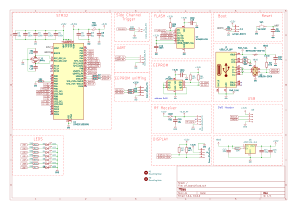
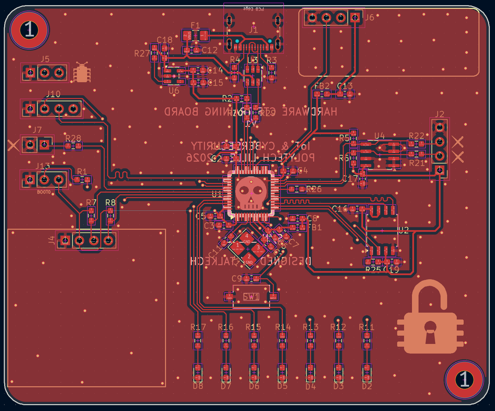
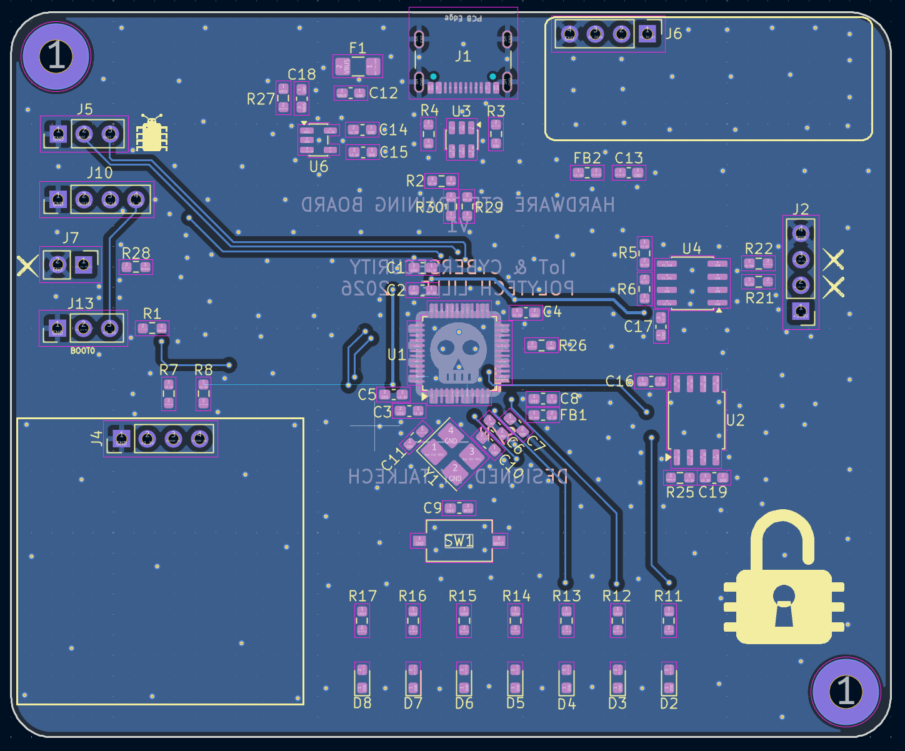
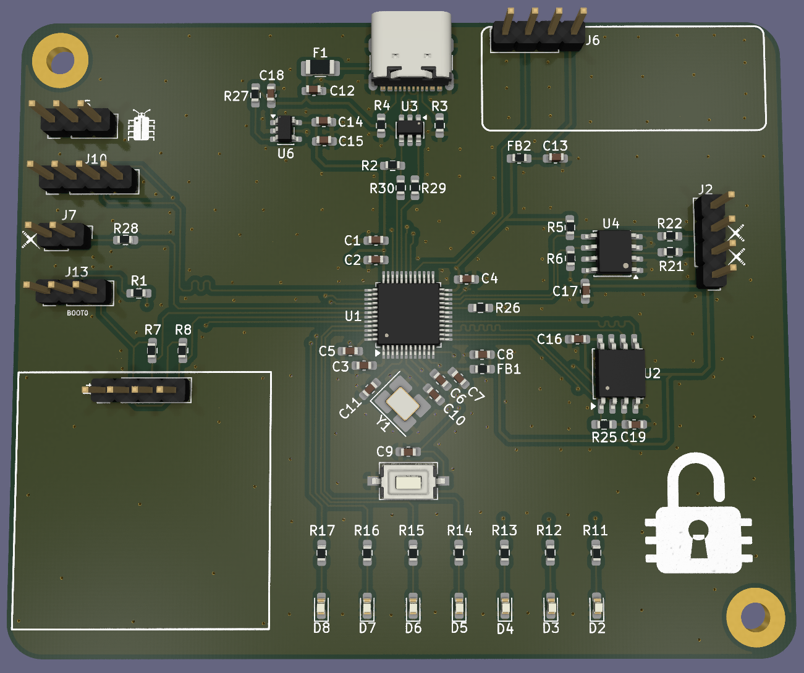
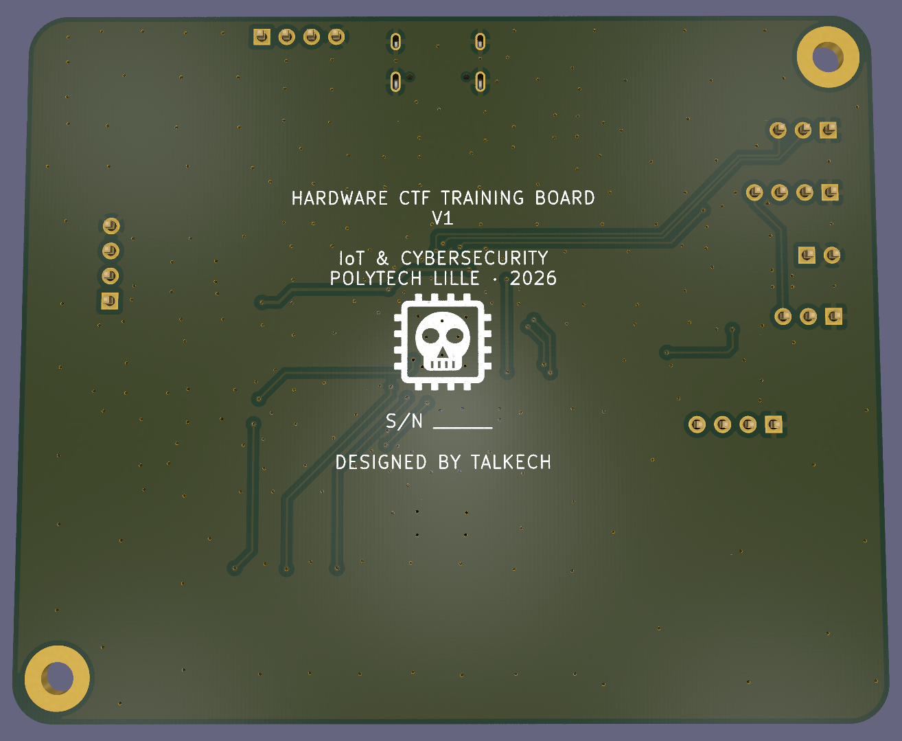

# Hardware
 
Hardware Hacking Training Board V1
 
## Schematic
 

 
## PCB layout
 
| Top | Bottom |
|-----|--------|
|  |  |
 
## 3D view
 
| Front | Back |
|-------|------|
|  |  |

## Software

Kicad 10